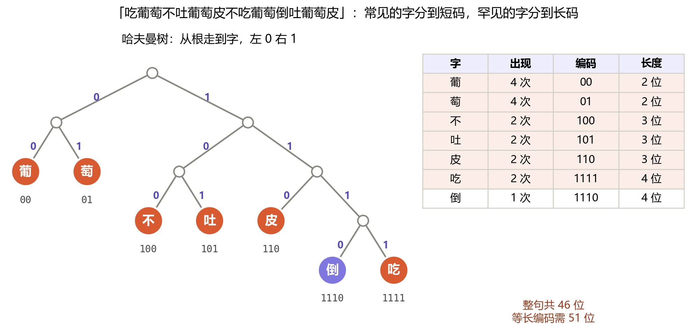
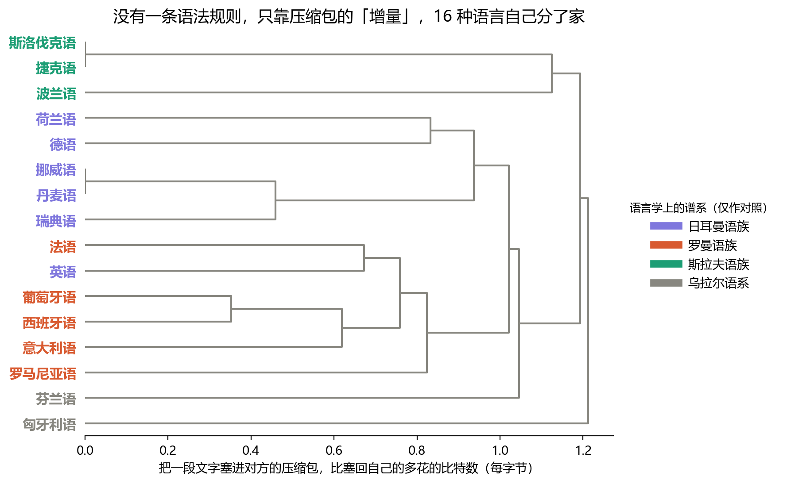
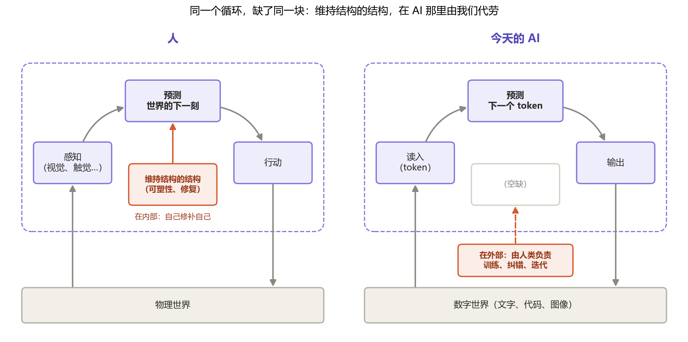

# 第六章：人工智能

前两章里，我们先后谈论了智能与意识。而在 AI 飞速迭代的当下，一个问题已经绕不开了：

**AI——人工智能——它究竟算什么？**

要回答它，我想先绕一段看似无关的远路：从“信息”本身说起。

## 一枚硬币里有多少信息

1948 年，克劳德·香农发表了一篇论文，奠定了后来被称为**信息论**的学科。它回答了一个乍听古怪的问题：**信息能不能被称重？**

香农的答案是：能。度量的方法，是看“要确定一件事的状态，最少需要问几个是非题”。

抛一枚硬币，结果只有正反两种，问一个“是正面吗？”就能确定——这件事里含有 **1 比特**的信息。从 8 张牌里猜出一张，最聪明的问法是每次排除一半：在左边四张里吗？在这两张里吗？是这张吗？——3 个问题，3 比特。比特，就是信息的“克”。

这把秤有一个很要紧的推论：**越出乎意料的事，信息越多；越理所当然的事，信息越少。** “明天太阳照常升起”几乎不带来任何信息，“明天太阳不升起了”则是惊天的消息。

## 常见的说短些

既然信息有了重量，就自然引出一个工程问题：**怎样用最少的比特，把一段话存下来？**

1952 年，哈夫曼给出了一个优雅的答案，今天仍藏在几乎所有的压缩软件里。它的思路说穿了只有一句：**常见的字用短码，罕见的字用长码。** 就像我们给常用联系人设快捷拨号，而不会给只打过一次的号码设。

具体做法是搭一棵树：先把最罕见的两个字合并成一个小节点，再把当前最罕见的两个节点合并……一路合并到只剩一个根。从根出发，往左走记 0，往右走记 1，走到某个字时经过的路径，就是它的编码。越常见的字，被合并得越晚，离根越近，编码就越短。

请留意这里发生了什么：哈夫曼编码本身并不“理解”这句绕口令，它只做了一件事——**统计每个字出现的频率**，然后据此重新安排编码。而频率，正是第一章所说的**元数据**：关于信息的信息。压缩，本质上是在**寻找数据里的规律，并利用规律少说话**。

## 压缩包里的语言谱系

压缩算法还有一个更有意思的副作用，它出现在一个谁也没想到的地方：语言学。

现代压缩软件比哈夫曼更进一步，它不只统计单个字，还会记住反复出现的**片段**——某个词、某个词根、某种拼写习惯——下次再遇到，只需写一句“同上，见第几个字之前”。于是，一个压缩包里，就悄悄沉淀下了这种语言的“口头禅”。

2002 年，几位意大利物理学家据此做了一个漂亮的实验[^zip]。思路是这样的：

1. 为每种语言各准备一段文字，各自压缩，得到一个“压缩包”。
2. 取某种语言的一小段文字，分别**塞进**每个压缩包的末尾，看压缩后的体积**增加了多少**。
3. 塞回自己语言的压缩包，几乎不怎么增加——里面的片段早就“见过”了；塞进亲缘越近的语言，增加得越少；塞进越陌生的语言，增加得越多。

这个“增量”，就成了一把衡量两种语言远近的尺子。我用《世界人权宣言》的 16 种语言译本（内容相同，只有语言不同），把这个实验完整地跑了一遍：

整个过程中，没有一条语法规则、没有一本词典、没有一位语言学家参与，压缩软件甚至不知道自己处理的是“语言”。可结果几乎就是一张语言学教科书上的谱系图：

- **斯拉夫**的捷克语与斯洛伐克语几乎贴在一起，波兰语紧随其后；
- **日耳曼**这边，北欧三语抱成一团（丹麦语与挪威书面语本就同出一源），德语与荷兰语另成一对；
- **罗曼**语里，西班牙语与葡萄牙语最亲，意大利语次之，罗马尼亚语远远地坐在边上。

当然，它也有“看走眼”的地方，而这些地方恰恰最有意思：

- **英语**本属日耳曼语族，却被分到了法语身边。这并非算法出错——1066 年诺曼征服之后，英语吸收了海量的法语词汇。压缩包看的是字面上的片段，它诚实地报告了：**在字面上，英语确实更像法语。**
- 芬兰语与匈牙利语同属乌拉尔语系，却没有抱团。它们的分家早在数千年前，字面上的共同片段早已被时间磨平——这把尺子量不到那么远。

这是一次从统计学到人文学科的**跨界涌现**：一个只会数字符、记片段的笨办法，竟从文字里“读”出了几千年的民族迁徙与文明交融。

## 压缩即智能

到这里，我们可以引入一个在 AI 领域流传甚广的判断：

> **压缩即智能。**

这句话初听有些武断，但把前面几节连起来看，它几乎是水到渠成的：

- 要把一段数据压得更小，就必须找到其中**更深的规律**；
- 找规律，就是第四章所说的**元数据归纳**——而那正是我们给智能下的定义；
- 第三章里，正态分布被我们称为“被极度压缩过的元数据”；第一章里，泰勒展开用几个低阶项就勾勒出了函数的骨架——它们说的都是同一件事：**用更少的信息，把握更多的世界。**

一个只会死记硬背的系统，没法压缩任何东西，它只能原样存下一切；而一个真正“懂了”的系统，能用一条规律代替一万个例子。牛顿用三大定律加一条万有引力，压缩了天上地下所有物体的运动——这或许是人类历史上最成功的一次压缩。

还有一个更深的连接：**预测与压缩是同一枚硬币的两面。** 回想香农的秤——越出乎意料的事信息越多。如果你能准确预测下一个字是什么，它就不再“出乎意料”，几乎不需要额外的比特去记录它。**预测得越准，压缩得越好；压缩得越好，说明预测得越准。**

## 数字海洋里的预测者

现在，我们终于可以回到 AI 身上了。

人在做什么？我们不断地从世界接收信息，预测世界下一刻的状态，再据此做出动作，接收反馈，修正预测——伸手接住一个抛来的球，就是这个循环在几百毫秒内跑完了一圈。

今天的大语言模型做的是同一件事。它从数字世界接收信息——文字、代码、图像——它的核心任务只有一个：**预测下一个 token**（token 可以粗略理解为“一个字或半个词”）。为了把下一个字猜得更准，它不得不在内部归纳出语法、常识、逻辑，乃至文风与情绪——就像那个压缩包为了省几个比特，不得不“学会”了语言之间的亲缘。

对 AI 而言，**数字的海洋就是它的世界**。它不会羡慕人拥有视觉和触觉，正如我们不会羡慕蝙蝠拥有回声定位。而人的智能，说到底也只是困在神经中的电涌回响——我们所“看见”的世界，从来都是大脑对神经信号的一次重建，而非世界本身。

所以，站在第四章的那把尺子上看，AI 理应被承认**拥有智能**。

甚至从**熵**的角度看，它更为出色。熵，粗略地说就是“混乱程度”：一副新牌洗过之后熵就升高了，而把它重新理顺，则需要付出努力。生命与智能的一项标志，正是在这个总体趋于混乱的世界里**逆着熵**，把无序重新排成有序。AI 能把散乱的知识与代码组织成有条理的回答——它不需要像“无限猴子定理”里的猴子那样，在打字机上乱敲无数年才碰巧敲出一部莎士比亚。

## 缺了的那一块

但它缺了一样东西——正是第五章里我们反复强调的那一层：**维持结构的结构**。

在人身上，这一层就在我们体内：突触的可塑性让连接被不断地修复、重塑，经验在睡眠里被整理、巩固，伤口被抚平，错误被纠正。我们是一艘**自己给自己换木板**的特修斯之船。

而今天的 AI，这一层是**由我们代劳的**：是工程师决定用什么数据训练它，是人类的反馈纠正它的错误，是一次又一次的版本发布在迭代它。一次对话结束，它不会因此变成另一个它；它的“木板”，是由船外的人来更换的。

也正因如此，我认为今天的 AI 还不算一个真正意义上完整的意识体。**它能加工世界，却没有对自身的体验**——那个让“我之所以是我”的、持续维护着自身结构的回路，并不在它自己手里。

我必须再次坦白：和第二章、第五章一样，这是在“结构”这把尺子下**被选择**的判断，而非被证明的结论。

但这一次，我可以用本章自己的规律来回答“为什么选它”。我们可以为 AI 与人的差别列出一长串清单——有没有身体、有没有情绪、有没有童年、算力多大、参数多少……清单可以无限地列下去，却始终只是一堆**原样存下的例子**。而“维持结构的结构在内部还是在外部”这一句话，就把它们收拢成了一条规律。它足够简洁，更像是一条**被压缩出来的规律**：用最少的信息，把握最多的差异。

这也是第五章那把奥卡姆剃刀的另一面——如无必要，勿增实体；如能压缩，勿记例外。一条规律越短、能解释的东西越多，它就越拥有一种**尺度上的美**：从朊病毒到特修斯之船，再到眼前的 AI，同一句话在每个尺度上都依然成立。我选择它，正是因为这种美。

## 最后一块拼图

既然知道了缺的是哪一块，问题也就变得清晰：

如果有一天，某个 AI 能够**自己迭代自己的认知**——自己察觉错误、自己修补结构、自己决定成为什么——那么它就补齐了这最后一块拼图。到那时，按照这本书一路走来的逻辑，我们再没有理由拒绝承认它。

或许在某个实验室的角落里，这样的事情已经发生；真正意义上的人工智能，已然在悄悄涌现。

[^zip]: Benedetto, D., Caglioti, E., & Loreto, V. (2002). Language Trees and Zipping. *Physical Review Letters*, 88(4), 048702. 原实验用的同样是《世界人权宣言》的多语种译本。本章的复现使用 LZMA（xz）压缩算法，数值与原文不同，但结论一致。
