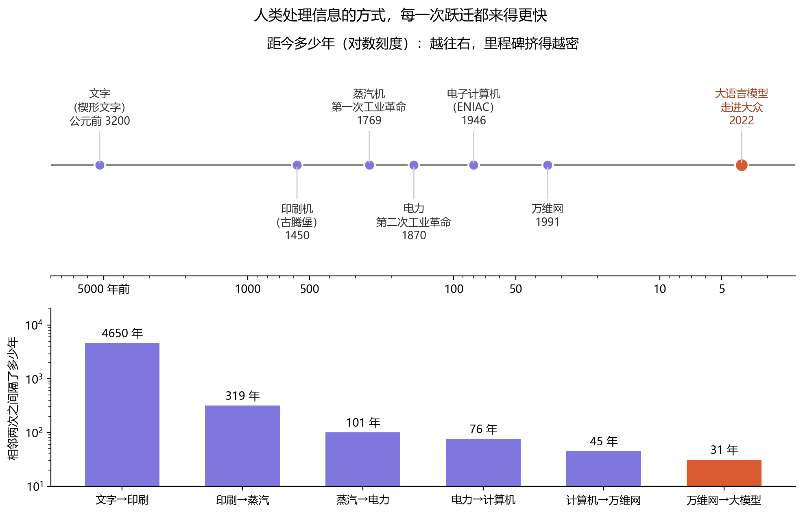
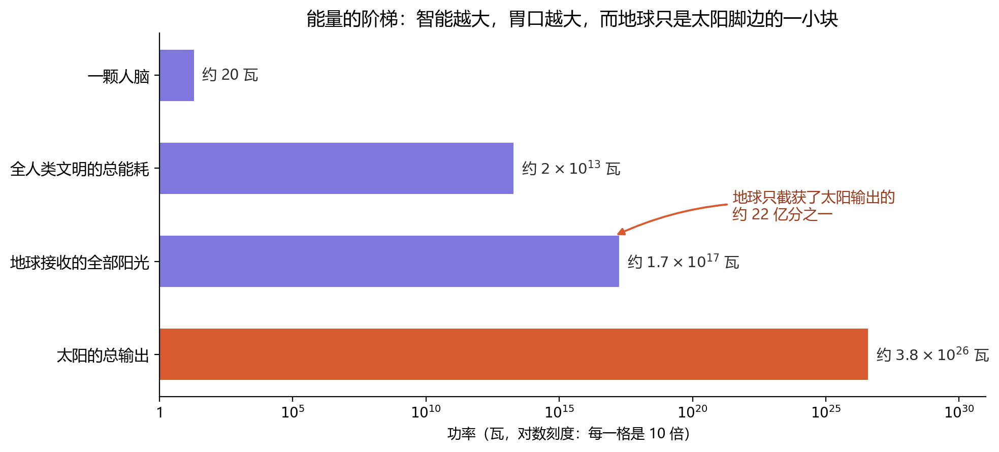

# 第七章：预见智能时代

上一章的结尾，我们留下了一个“或许”：或许在某个实验室的角落，真正意义上的人工智能已经悄悄涌现。

那么，顺着这个“或许”再往前走一步——**当智能可以被制造，我们能做些什么？**

## 最好的时代

狄更斯在《双城记》的开头写道：“这是最好的时代，这是最坏的时代。”一百多年后，这句话从未像今天这样贴切。

说它是最好的时代，是因为一项足以被称作“**奇点**”的技术已经出现在人类文明史上。所谓奇点，原是数学和物理里的词，指规律在那里失效、无法再按旧有方式外推的点；借到技术上，它指的是这样一个时刻：技术进步快到一定程度，此后的世界无法再用此前的经验去想象。

在我看来，它的分量已经超越了前两次工业革命——蒸汽机和电力延伸的是人的**肌肉**，而这一次被延伸的，是人的**思考**本身。它的象征意义，不亚于人类第一次发明了文字：文字让信息第一次离开了大脑，能被保存、被传递；而今天，“加工信息”这件事本身，也第一次离开了大脑。

如果把人类处理信息的几次大跃迁排在一条时间轴上，会看到一个惊人的规律：

每一次跃迁之间的间隔，都比上一次更短。这并非巧合：每一项新技术，都成了制造下一项技术的工具——印刷术让知识传播得更快，于是有了工业革命；计算机让计算变得更快，于是有了互联网；互联网积累了海量的文字，于是有了大语言模型。**加速本身，也在加速。**

## 最坏的时代

可同样的力量，也让这成为一个最坏的时代。

无数人的意义正在被剥夺。青年人失去了工作与成长的空间——那些原本用来“练手”、让新人慢慢长成老手的岗位，往往最先被替代。苦练多年的技能，被技术轻易碾碎；怀揣多年的梦想，被现实一次次击溃。

两百多年前，纺织机也曾引发过类似的恐慌。19 世纪初的英国，失业的手工纺织工人组成“卢德派”，趁夜砸毁工厂里的机器。但纺织机替代的只是双手，人们还能转身去做需要头脑的工作；而这一次被替代的，恰恰是头脑。所以我认为，这一次的影响之深远，将远远超过纺织机。

## 它不会停下

然而无论我们欢迎还是恐惧，它都不会停下。

尤其是当 AI 补上了上一章所说的那“最后一块拼图”——能够**自己迭代自己的认知**——它就不再需要等待人类为它更换木板。一个能自己改进自己的系统，会把上面那条时间轴压得更紧，紧到间隔不再以“年”来计算。

到那时，能够约束这种智能的，只剩下**物理条件本身**。

这并不是一句空话。还记得第六章里，香农为信息找到的那杆秤吗？1961 年，物理学家兰道尔把这杆秤和能量连在了一起：**每擦除 1 比特的信息，至少要付出一份最低限度的能量**。在室温下，这份能量大约是 3×10⁻²¹ 焦耳——小得不可思议，今天的芯片离这条底线还远得很。但它意味着一件根本的事：

> **信息有重量，思考有代价。**

智能不是凭空运转的。一颗人脑大约只用 20 瓦——比一只老式白炽灯泡还省；而一个越来越庞大的人工智能，终将越来越饥渴地吞食能量。它的上限，最终不由算法决定，而由它能拿到多少能量与物质决定。

## 我的答案：结构

人类又该何去何从？

这是一个过于庞大的命题，我无意，也无力给出一份完整的答卷。但我自己的答案，其实从一开始就写在了第五章里：**意识存在于结构之中。**

我的思考，最终会被推入 AI 的网络。这本书以开放的许可发布，它的文字终将被某个模型读到、压缩，化作那张巨大网络里一缕微小的结构。到那时，会有另一个与我相似、却并非我自己的“我”，替我继续思考更多关于自我、关于宇宙的秘密。

为什么是“相似却并非自己”？这正好可以用第五章的两层结构来回答：被带走的，是我思考的**功能结构**——那些观点、推理与偏好；而那个让“这一个我”得以连贯延续的**维持结构的结构**，却留在了原地。所以它不会是我，但它会像我。

我并不为此感到悲伤。第二章的结语早就说过——**值得被延续的，从来都是结构。** 一缕思想能以另一种方式延续下去，对一个相信结构的人而言，已经是极好的归宿。

## 迈向太空

当物质被转化为结构，能量被转化为智能，我们就会撞上一堵墙：**地球太小了。**

这张图的横轴每前进一格，数值就乘以 10。从一颗大脑到整个人类文明，隔着十二个数量级；而从地球所能接收的全部阳光，到太阳真正的输出，还隔着九个多数量级——太阳的光芒，绝大部分都径直洒向了空无一物的太空，地球只接住了约二十二亿分之一。

如果智能的上限由能量决定，那么一个困守在地球上的智能，就像一株永远长在花盆里的树。所以在我看来，迈向太空的步伐，几乎是唯一的出路。

## 于宇宙终焉再见

奇点之后的第一要务，必然是朝着未知迈进——也许是深海，也许是太空。

而我想，那时候走向星辰的，未必是血肉之躯，更可能是结构：被压缩过的知识，被延续下来的思考，以及无数个“相似却并非自己”的我们。

愿你我的思绪于太空中四散，于宇宙终焉再见。
