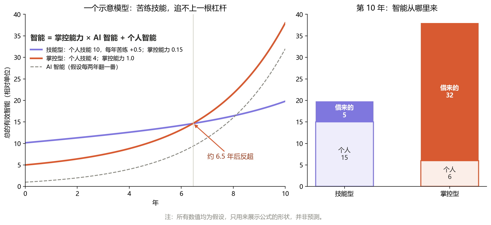
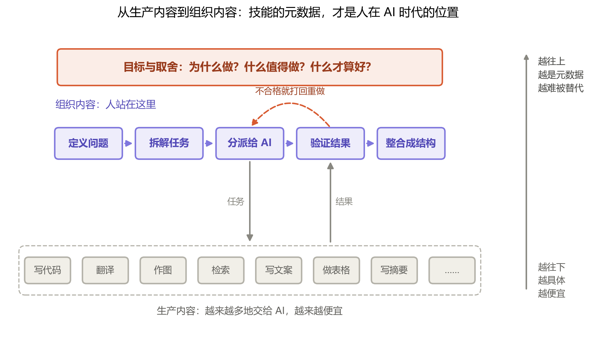

# 第七章：掌控智能

上一章，我们看清了今天的 AI 缺的是哪一块，也留下了一个“或许”：或许某一天，它会自己补齐。可在那之前——也就是此时此刻——对一个具体的人来说，更迫切的往往是一个近得多的问题：

**在 AI 越来越聪明的今天，我自己，该把力气花在哪里？**

这一章，我想给出一个尽量具体的回答。至于整个文明将走向何方，留给最后一章。

## 一道公式

我的回答，可以先浓缩成一道式子：

> **智能 ＝ 对智能的掌控能力 × AI 智能 ＋ 个人智能**

这里的“智能”，指的是一个人最终能拿出来的、真正落地的智能。三个部分分别是：

- **个人智能**：不借助任何工具，你自己的头脑和双手能做到的事。
- **AI 智能**：你手边的 AI 本身有多强。它对所有人几乎一样，而且正在急速膨胀。
- **对智能的掌控能力**：你能把 AI 的能力，**转化成多少属于你的成果**。它是一个系数：为零，AI 再强也和你无关；越高，AI 的能力就有越多被你接住。

打个比方：AI 智能是发动机的马力，掌控能力是驾驶的技术，个人智能是你自己步行的速度。发动机从一百匹涨到一万匹，一个不会开车的人，依然只能走路——甚至可能把车开进沟里。

这道式子不是被证明的定律，而是我**选择**的一把尺子。它粗糙，却抓住了一个要紧的形状——**前一项是乘法，后一项是加法。**

## 当乘法遇上指数

加法和乘法的区别，平时不起眼，一旦其中一个量开始暴涨，差距就会变得惊人。

图里有两个人。**技能型**的人起点更高，个人技能是 10，并且每年都在勤勤恳恳地苦练；但他几乎不借助 AI，掌控能力只有 0.15。**掌控型**的人个人技能只有 4，进步也慢，但他善于提问、拆解、验证，掌控能力是 1.0。

在 AI 还弱小的头几年，技能型遥遥领先——苦练是有用的。可 AI 每翻一番，掌控型手里的那根杠杆就跟着长一倍；苦练却只能一点一点往上加。大约六年半之后，曲线交叉了。到第十年，掌控型的人拿出来的智能，大部分是“借来的”。

图里的数字都是我假设的，换一组数，交叉点会提前或推后。但只要 AI 还在加速，**这个交叉迟早会到来**：加法追不上乘法，苦练追不上杠杆。

所以，我的结论是：**随着 AI 智能的急速膨胀，对智能的掌控能力，才是真正意义上的出路。**

## 掌控能力是什么

“掌控能力”听起来抽象，但拆开看，它是几件非常具体的事：

- **定义问题。** AI 的本事是预测“下一个字”。可它预测什么，取决于你问什么。一个连自己都说不清楚的问题，AI 也只能给出一个说不清楚的答案。
- **拆解任务。** 把一个大目标切成 AI 能一口吃下的小块，并且知道哪一块该先做。
- **验证结果。** 判断它给的东西对不对、好不好。这是最容易被忽视、也最要紧的一环。
- **整合成结构。** 把零散的产出，组织成一个能用、能延续的整体。
- 在这一切之上，还有**目标与取舍**：为什么做？什么值得做？什么才算好？

这里有一件很有意思的事：**这几件事，恰好就是今天的 AI 所缺的那一块。** 它能生产，却不会自己定义目标，不会自己察觉错误、修补自身——它的“维持结构的结构”在外部，由人类代劳。

换句话说，人在 AI 时代的位置，正是 AI 身上空着的那个位置。

### 为什么验证最要紧

我们已经知道：用不可靠的零件，也能搭出可靠的系统，但前提是有纠错的结构，并且零件的出错率在阈值之内。

AI 正是一种强大却不完全可靠的零件——它会犯错，而且常常错得一本正经。**验证，就是你为它搭建的纠错结构。** 如果你的判断力在阈值之上，AI 越强，你的系统越可靠；可如果你根本分辨不出对错，把错误当成答案照单全收，那么 AI 越强，错误就被放大得越快。这时，公式里那个掌控能力的系数，实际上是**负的**。

## 追求技能的元数据

那么，掌控能力从哪里来？我的回答是：**放弃以技能为核心的思维，转而追求技能的元数据。**

元数据是“关于信息的信息”，而它最重要的性质之一，是**泛性**——内容完全不同的东西，能被同一个元数据放上同一把尺子。技能也是如此：

- 会用某一款绘图软件，是技能；知道一张好图要传达什么、该删掉什么，是技能的元数据。
- 会写某一种编程语言，是技能；知道一个系统该怎么拆分、怎么测试、哪里最容易出错，是技能的元数据。
- 能把一段英文译成中文，是技能；知道读者是谁、语气该如何拿捏、哪些意思在翻译中最容易丢失，是技能的元数据。

具体的技能，会随着某一款工具、某一代 AI 一起过时；技能的元数据，却能从一种工具迁移到另一种工具，从一个领域迁移到另一个领域。而我们给智能下的定义，正是“归纳元数据的能力”——所以，追求技能的元数据，本身就是在锻炼智能。

元数据还会“信息退化”：越往高层，越平滑，细节越少。在过去，这是它的缺点——细节是手艺人的饭碗。而在今天，细节正在被交给 AI；你需要握在手里的，恰恰是那层更平滑、更通用的东西。

### 放弃技能核心，不是放弃技能

这里必须说清楚一个容易被误解的地方。

元数据是从具体的信息里**归纳**出来的。没有亲手做过一些事，就不可能真正知道“怎样才算做得好”——而这正是验证所需要的判断力。一个从没写过代码的人，很难判断 AI 写的代码好不好；一个从没认真写过文章的人，也很难看出 AI 文章里的空洞。

所以，放弃的是“以技能为核心”的思维，而不是技能本身。技能不再是终点，而是你归纳元数据的**原材料**。我们依然要动手，只是动手的目的变了：不是为了比 AI 做得更快，而是为了知道什么才是好的。

## 组织，比生产更重要

当生产变得廉价，什么会变得昂贵？

历史上发生过一次类似的事。印刷术普及之后，靠手抄书为生的抄写员渐渐消失了；可与此同时，编辑、出版人、图书馆员、百科全书的编纂者却兴盛起来。书多到读不完的时候，真正稀缺的，变成了**选择什么、如何编排、怎样让人找到**。

今天，AI 把“生产内容”的成本压向了零：文章、代码、图片、方案，几乎可以无限地生成。内容像洪水一样涌来，而一堆无人组织的内容，和一堆没有结构的原子一样——它们存在，却没有意义。

值得被延续的，从来都是**结构**；而压缩，就是从数据里找出规律，把它们收拢成结构。**组织内容，正是在洪水般的内容之上搭建结构。** 所以在 AI 时代，组织内容将比生产内容更加重要。

这本书本身就是一个小小的例子。书里不少插图的代码、许多段落的润色，是在与 AI 的协作中完成的；但写什么、不写什么，选哪一把尺子，哪一句必须坦白——这些组织，始终在我自己手里。

## 写给明天早上的几条建议

把这一章落到地面，大概是这样几件小事：

1. **每学一项技能，就追问它的元数据。** 为什么要这样做？什么时候不该这样做？怎么判断做得好坏？
2. **练习把问题说清楚。** 在向 AI 提问之前，先试着用一句话写下你到底想要什么。
3. **为 AI 的产出搭一个检查结构。** 换个方式再问一遍，找另一个来源对照，先在小范围里试一试——别让错误顺着杠杆被放大。
4. **维护你自己的知识结构。** 笔记、清单、体系——它们是你的“维持结构的结构”，让你今天学到的东西，明天还在。
5. **保留一块亲手做的领地。** 判断力只能从实践里长出来。

## 结语

回头看，这本书一路都在说同一件事：重要的不是构成，而是结构。

AI 时代，这句话有了一层最切身的含义：**AI 会生产越来越多的内容，而人的位置，在于让这些内容成为结构。**
