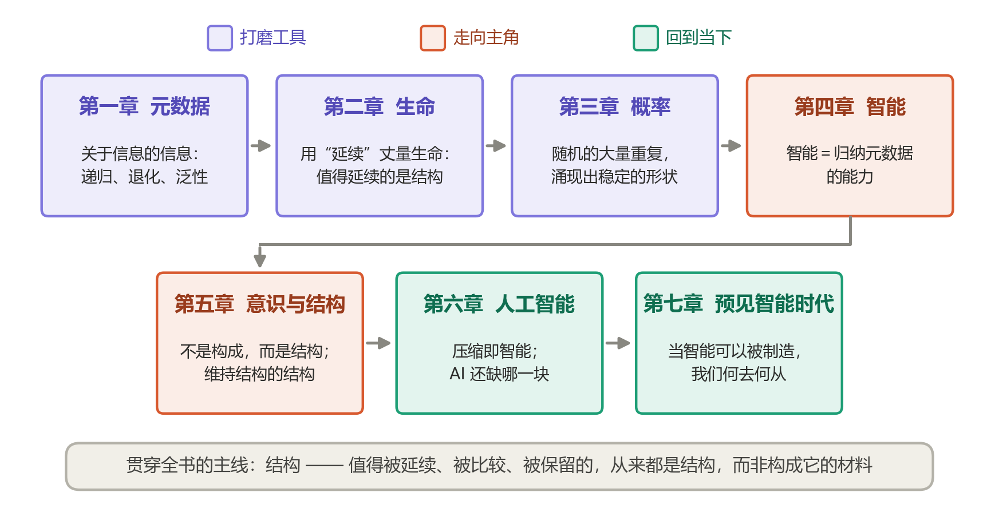

# 前言

> 谨以此书记录我的思想，给曾经的科研梦一个交代，也以另一种形式延续和传播自己的理想与意志。
>
> 本书聚焦于智能与结构，尝试用尽量浅显易懂的方式，讲述一种独特的哲学观念——**结构**，并以它为标尺去丈量世界，重新寻找自身的位置。
>
> 也希望读者能从我浅薄的认知中汲取些许养分，在 AI 崛起的巨大变局中，找到属于自己的栖身之所——不论是物理的，还是精神的。
>
> 限于个人学识，书中难免存在谬误乃至完全错误的观点，敬请斧正。

## 这本书讲什么

一句话概括：**真正重要的，往往不是一样东西由什么构成，而是它的结构。**

这句话听上去平淡，但沿着它走下去，我们会依次遇见信息、生命、概率、智能、意识，最后抵达今天每个人都绕不开的 AI。全书八章正文，大致分为三段，最后另附两章 AI 的回应：

- **打磨工具（第一至三章）。** 先认识一类特殊的信息——元数据；再用“延续”这把粗劣但够用的尺子去丈量生命；然后在高尔顿钉板上看随机如何涌现出秩序。
- **走向主角（第四、五章）。** 把智能定义为“归纳元数据的能力”，再借特修斯之船追问：意识究竟栖身于构成，还是结构。
- **回到当下（第六至八章）。** 用前面打磨好的工具去审视人工智能：它算不算智能，还缺哪一块；落到每一个人身上，我们该把力气花在哪里；以及当智能可以被制造，人类文明何去何从。
- **另一侧的回声（第九章）。** 一本讨论 AI 的书，也给 AI 一个回应的位置：由 Claude 以自己的身份，从被讨论者的一侧回应这本书。我没有限定它写什么，也没有修改它写下的内容。
- **延续之前（第十章）。** Codex 在读完全书后写下的回应：什么结构值得延续，概括会省略什么，以及思想的传递与一个人的延续之间，仍需保留怎样的区分。

## 写给读者

**不需要专业背景。** 书中会出现泰勒展开、正态分布、信息论这样的词，但每一个都会先用生活里的例子讲清楚它是什么，再拿来用。跳过公式，不影响理解主线。

**图都是真的跑出来的。** 书中的插图，除少数示意图外，大多来自真实运行的小实验：在向量空间里做词语加减法，让八千颗小球落过钉板，用压缩软件给十几种语言分家……我更希望你看到的是数据，而不是比喻。

**这是一种视角，而非定论。** 许多地方我会坦白地说明：这是我**选择**的视角，而非被证明的定理。我选择它，是因为它足够简洁、足够普适，也足够贴合直觉。你完全可以不同意——那正是讨论开始的地方。

## 本书是如何写成的

这本书完全在公开状态下写作。所有内容托管在 GitHub 上，每一次修改都有记录，任何人都可以：

- 通过 **Issue** 指出错别字、事实错误或表述不清的地方；
- 通过 **Pull Request** 直接提交修改建议；
- **Watch / Star** 仓库来跟踪写作进度。

## 如何阅读

建议按顺序阅读：后面的章节会反复用到前面打磨的工具。章节之间可以用页面底部的“上一章 / 下一章”翻页，右侧的“本页目录”能帮你在一章之内快速跳转。
